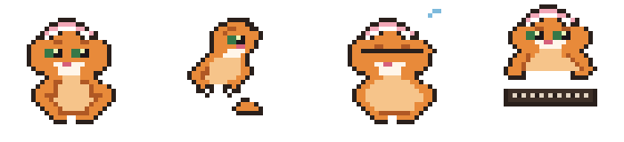
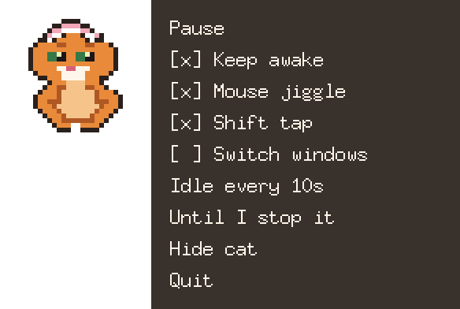

# Catsitter

A small pixel-art cat that sits on your desktop and keeps your computer awake.

<p align="center">
  
</p>

While Catsitter runs, it stops the system and the display from going to sleep. Once you've been idle for a while, it moves the mouse a pixel and back and taps Shift, so chat apps and screen locks don't decide you've gone. The cat paws at its little keyboard each time. Pause it and the cat falls asleep.

It runs on macOS, Windows and Linux.

## Install

macOS and Linux:

```sh
curl -fsSL https://github.com/xanderwasserman/catsitter/releases/latest/download/install.sh | sh
```

Windows (PowerShell):

```powershell
irm https://github.com/xanderwasserman/catsitter/releases/latest/download/install.ps1 | iex
```

You don't need sudo or administrator rights. The script downloads the latest release for your machine, checks it against the release's `checksums.txt`, installs it for your user and starts Catsitter.

| System | Installed to |
| --- | --- |
| macOS | `~/Applications/Catsitter.app` |
| Linux | `~/.local/bin/catsitter`, plus a desktop entry and an icon |
| Windows | `%LOCALAPPDATA%\Programs\Catsitter`, plus a Start Menu shortcut |

On Linux, the script prints the line to add to your shell profile if `~/.local/bin` isn't on your `PATH`. On Windows it does the same for your PowerShell profile, but you only need that if you want to run `catsitter` from a terminal.

### Update

Run the install command again. If you already have the latest version, the script leaves it alone. Otherwise it stops Catsitter if it's running, replaces it and starts the new version. On macOS, read [the note about Accessibility after an update](#macos).

### Install a specific version

```sh
curl -fsSL https://github.com/xanderwasserman/catsitter/releases/latest/download/install.sh | sh -s -- --version 0.1.0
```

```powershell
iex "& { $(irm https://github.com/xanderwasserman/catsitter/releases/latest/download/install.ps1) } -Version 0.1.0"
```

### Uninstall

```sh
curl -fsSL https://github.com/xanderwasserman/catsitter/releases/latest/download/install.sh | sh -s -- --uninstall
```

```powershell
iex "& { $(irm https://github.com/xanderwasserman/catsitter/releases/latest/download/install.ps1) } -Uninstall"
```

Uninstalling stops Catsitter and removes the app (on macOS it also clears the Accessibility entry). Your [settings file](#settings) stays in place.

## First launch

The installer starts Catsitter for you. After that, open it like any other app: from Launchpad, Spotlight or Finder on macOS, the Start Menu on Windows, or your application menu on Linux. Catsitter doesn't start at login by itself, so after a restart you open it again.

### macOS

Catsitter needs Accessibility permission to move the mouse and press Shift. On first launch it explains why and offers an **Open Settings** button, which takes you to System Settings → Privacy & Security → Accessibility. Turn on the switch next to Catsitter. (On macOS 11 and 12 the same list is under System Preferences → Security & Privacy → Privacy → Accessibility.) Catsitter notices within a couple of seconds and shows "Thanks! Catsitter can nudge now."

Until you allow it, Catsitter keeps the screen awake but skips the mouse and Shift nudges. The cat's menu and the menu-bar menu both say that nudges are paused, and both have an **Allow Accessibility** item that shows the explanation again.

**After every update you need to turn the switch on again.** The app isn't signed, so macOS treats each new build as a different app. The installer removes the old entry and reminds you. When it restarts Catsitter, Catsitter asks again and you turn the switch back on.

- Start Catsitter as an app, not by running the binary from a terminal. macOS gives the permission to whatever launched the program, so a terminal launch asks for the terminal instead.
- The app is unsigned. The installer clears the quarantine flag, so Gatekeeper usually stays quiet. If it does block Catsitter, go to Privacy & Security and choose **Open Anyway**.
- Catsitter has no Dock icon. Its controls are in the menu bar, as a small cat face.

### Windows

SmartScreen may warn that the app is unrecognized. Choose **More info**, then **Run anyway**. The Catsitter icon goes in the system tray. If you can't see it, check the hidden-icons overflow (the `^` arrow).

### Linux

The icon goes in your panel's system tray. Catsitter uses the StatusNotifierItem (AppIndicator) tray. KDE shows them out of the box. Stock GNOME doesn't, so install and enable the **AppIndicator and KStatusNotifierItem Support** extension (Ubuntu has this enabled already). Without a tray you can still do everything from the cat's right-click menu, except bring back a hidden cat (see [Hide cat](#using-it)).

Catsitter needs an X11 display. On Wayland that means XWayland, which most desktops include. The nudges and idle detection go through X11, so under Wayland native Wayland apps might not see the nudges, and typing in them might not count as activity.

If the app doesn't start, install the usual graphics client libraries. On Debian or Ubuntu these are `libgl1`, `libx11-6`, `libxrandr2`, `libxinerama1`, `libxcursor1`, `libxi6`, `libxrender1` and `libxext6`.

## Using it

<p align="center">
  
</p>

Right-click the cat to open its menu, or use the tray or menu-bar icon. Both menus have the same controls:

- **Pause / Resume**: stop everything for now, including the sleep inhibitor, so the machine can sleep. The cat sleeps until you resume.
- **Keep awake**, **Mouse jiggle**, **Shift tap**, **Switch windows**: turn each action on or off (see below).
- **Idle every**: how long you need to be idle before a nudge: 5s, 10s, 30s, 1m, 2m, 5m or 10m.
- **Until I stop it / For 2h**: how long to keep watch: 30m, 1h, 2h, 4h, 8h, or until you stop it. When the time is up, Catsitter quits and releases the inhibitor. Time spent paused doesn't count. The choice is saved, so later launches stop after the same time until you change it.
- **Hide cat / Show cat**: hide the cat and keep working in the background. The cat stays hidden across restarts, and only the tray icon can bring it back. With no tray, quit Catsitter and set `"hidePet": false` in the settings file.
- **Quit**.

In the tray, the idle time and the watch time are submenus. In the cat's menu, each click steps to the next value and closes the menu, so right-click again to keep going.

Drag the cat to move it. It remembers where you left it. Press Escape or click somewhere else to close its menu.

### Keep-awake actions

| Action | Default | What it does |
| --- | --- | --- |
| Keep awake | on | Holds a sleep inhibitor so the system and display stay awake. It's held the whole time Catsitter runs, whether you're idle or not. |
| Mouse jiggle | on | Moves the pointer 1 pixel and back when you're idle. |
| Shift tap | on | Taps the Shift key when you're idle. |
| Switch windows | off | Presses Cmd+Tab on macOS, or Alt+Tab on Windows and Linux, when you're idle. |

Nudges only happen after you've been idle for the full interval (10 seconds by default), and at most once per interval.

### Settings

Changes you make in either menu are saved here:

| System | Settings file |
| --- | --- |
| macOS | `~/Library/Application Support/catsitter/config.json` |
| Linux | `~/.config/catsitter/config.json` |
| Windows | `%AppData%\catsitter\config.json` |

The jiggle distance (`pixels`), the number of window switches (`tabs`) and the switch modifier (`modifier`) aren't in the menus. Change them by editing this file while Catsitter isn't running, or for one run with the flags below.

## Command-line flags

Flags apply to a single run and aren't saved to the settings file. Any flag you leave out uses your saved setting, so the defaults below only apply if you haven't changed that setting.

| Flag | Meaning |
| --- | --- |
| `--seconds N` | Idle seconds before a nudge (default 10). |
| `--pixels N` | Mouse jiggle distance in pixels (default 1). |
| `--mode LETTERS` | Which nudges to turn on: `m` mouse, `k` Shift key, `s` switch windows. Default `mk`. |
| `--tabs N` | Window switches per nudge (default 1). `0` picks a random 1 to 3. |
| `--key alt\|cmd` | Modifier for window switching. Default `cmd` on macOS, `alt` elsewhere. On Windows and Linux, `cmd` means the Windows/Super key. |
| `--duration D` | How long to keep watch, for example `10m`, `2h`, `1.5h`, `2h30m` or `90s`. `unlimited` or `forever` means no limit. |
| `--inhibit`, `--no-inhibit` | Turn the sleep inhibitor on or off. |
| `--mouse`, `--no-mouse` | Turn the mouse jiggle on or off. |
| `--shift`, `--no-shift` | Turn the Shift tap on or off. |
| `--switch`, `--no-switch` | Turn window switching on or off. |
| `--no-pet` | Start with the cat hidden. |
| `--version` | Print the version and exit. |

Examples:

```sh
catsitter --seconds 30 --duration 2h
catsitter --mode mks --tabs 0
catsitter --no-pet
```

On macOS there's no `catsitter` on your `PATH`. Running the binary inside the app from a terminal makes macOS ask for Accessibility for the terminal (see [macOS](#macos)). Quit Catsitter first, then pass flags through `open` so the app keeps its own permission:

```sh
open ~/Applications/Catsitter.app --args --seconds 30 --duration 2h
```

## Build from source

You need Go 1.25 or newer.

```sh
go test ./...
go build -o catsitter ./cmd/catsitter
```

macOS builds need CGO (it's on by default) and the Xcode Command Line Tools, because Catsitter uses IOKit, CoreGraphics and AppKit. A local build is a bare binary, not an app bundle, so macOS gives the Accessibility permission to the terminal you run it from. Linux and Windows builds don't need CGO, so you can cross-compile them:

```sh
CGO_ENABLED=0 GOOS=windows GOARCH=amd64 go build -o catsitter.exe ./cmd/catsitter
CGO_ENABLED=0 GOOS=linux GOARCH=arm64 go build -o catsitter ./cmd/catsitter
```

The cat is drawn with [Ebitengine](https://ebitengine.org) in a small transparent window that stays on top. The sprites are original pixel art defined in `internal/pet/cat/art.go`.

## License

See [LICENSE](LICENSE).
